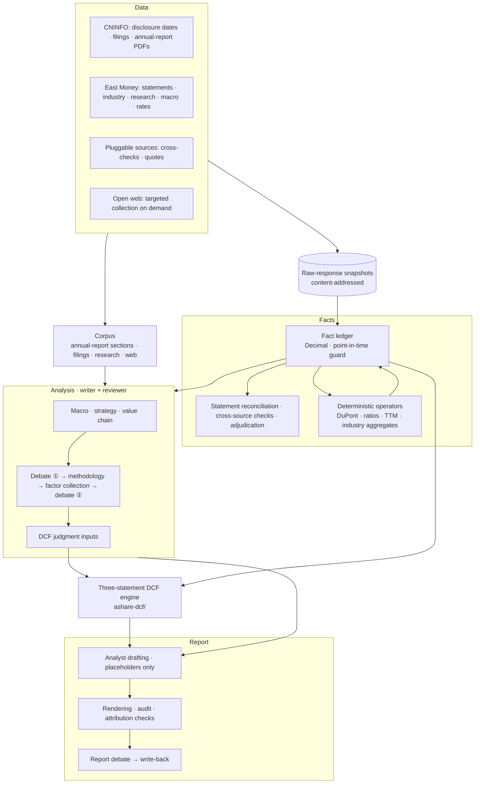
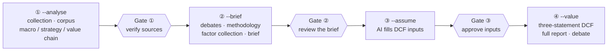
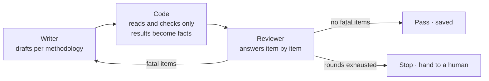

<div align="center">

# ir-agent

**An equity-research agent for China A-shares — from raw disclosures to a three-statement DCF, with every number traceable and every judgment reviewed.**


[简体中文](README.md) · [繁體中文](README.zh-TW.md) · **English**

</div>

---

Give ir-agent a stock code and a reporting year, and it runs a sell-side analyst's full workflow. It collects announcements, financial statements, quotes, broker research and public web pages, then analyzes the macro backdrop, strategy and value chain. Two rounds of bull/bear debate shape the revenue and margin drivers, and the agent fills in the DCF judgment inputs. The output is **a formula-driven, cell-by-cell verifiable three-statement DCF model** and **a complete research report**.

It is built against two failure modes of LLM-written research: **fabricated numbers**, and **judgments that reach the valuation without scrutiny**.

> ⚠ For research and education only. **Not investment advice.**

## Highlights

| | |
|---|---|
| 🔢 **Numbers cannot be fabricated** | The model writes only placeholders such as `[[key@period]]`. Code renders the true values from a fact ledger, and an audit blocks any bare number or forged reference. |
| ⏱ **Strict point-in-time discipline** | Every fact carries the moment it became knowable, and a guard refuses undisclosed data. Disclosure dates come from CNINFO filing dates, so backtests cannot leak future information. |
| ⚖️ **Writer + reviewer** | Two AIs share every judgment step. Code only checks facts and never rules. The reviewer answers a checklist generated from the methodology, giving one of four verdicts per item. Fatal items go back to the writer with fix suggestions. |
| 🧭 **Falsification, not agreement** | A bull/bear debate before modeling stops one-sided evidence picking. A debate after drafting challenges the text line by line, and every upheld challenge must be written back into the report. |
| 📊 **Professional three-statement DCF engine** | The engine links the three statements, forces the balance sheet to balance and keeps the terminal value Damodaran-consistent. It adds five sensitivity grids and Monte Carlo simulation. Everything is a live formula, recomputed cell by cell by a formula engine after generation. |
| 🚦 **A human is the final gate** | Three human sign-off gates; the run refuses to start without the signature. Any failed step can be rerun on its own, and steps that passed are reused. |

## System overview



## Workflow: four calls, three gates



| Call | What it does | Handed to the human |
|---|---|---|
| ① `--analyse` | Quantitative collection and corpus ingestion; macro view, strategy and value chain (each written and reviewed) | Source list (origin, local file and raw snapshot of every document) plus the review verdicts of the three qualitative modules |
| ② `--brief` | Debate ① → methodology research (a decomposition formula for revenue and gross margin) → targeted factor collection → debate ② (bear / balance / bull values per factor) → research brief | Brief, open-items list, decomposition, balance points |
| ③ `--assume` | AI fills three cases per factor per year; code synthesizes the revenue and margin paths | Every row's value, rationale, evidence and review verdict |
| ④ `--value` | Three-statement DCF → full report → report debate → write-back | Report and DCF workbook |

Each call first rebuilds the deterministic layer, which makes no model calls, then reads back the previous call's artifacts. A failed step is rerun on its own. Anything a human edits is labeled "edited by hand, not reviewed" all the way into the report appendix.

## How it works

### The fact ledger: where numbers come from

Every number enters the system through the fact ledger. Each fact carries its source, period, unit and **the moment it became knowable**. `ledger.get(key, period, as_of=…)` returns only the latest version disclosed by that moment. A request for an undisclosed number raises `LookAheadError`.

Raw API responses are stored content-addressed, and each fact points back to its snapshot through `source_id`. Statements use East Money as the primary source, cross-checked against Sina; disagreements are recorded and shown.

Validation reports keep "everything that ran passed" separate from "coverage is complete". Missing data is marked *skipped*, never disguised as *passed*.

### The placeholder contract: how the model writes numbers

The writer sees a fact list, with a label, a display value and a placeholder on each line. Ratio facts also show the raw ledger value, which prevents 100× misreadings between percentages and decimals:

```text
毛利率 (gross margin)   35.00%（账本原值 / raw 0.35）   写作 / write as [[gross_margin@2025FY]]
```

The text may contain only placeholders; code fills in the values and generates footnotes at render time. Every draft must pass three number gates: no bare numbers, no forged references, and at least one placeholder.

A separate **attribution gate** guards against fabricated sources. Whenever a quotation names its source ("according to the annual report, '…'"), code checks that the quote really appears in that source.

### Writer + reviewer: how judgment is checked



| Verdict | Meaning |
|---|---|
| Pass | The logic is fully sound and the evidence matches |
| Caution | The logic is partly sound and the evidence matches, but the conclusion is a stretch |
| Fatal | The logic cannot support the conclusion (a fix suggestion is required) |
| To collect | The logic is sound, but the evidence has not been collected yet |

- **Code checks; it does not reject.** It reports facts to the reviewer: whether a quotation exists, whether a paraphrased article is in the corpus, whether units line up. Code is good at "can this be computed, is there a source". Whether an argument holds is the reviewer's call.
- **Checklists come from the methodology, not the draft.** Porter's Five Forces is always five items; a force the writer skipped appears to the reviewer as "not given".
- **Writer and reviewer see the same materials.** The reviewer never fails the writer on data the writer never saw.
- **Stopping beats silent degradation.** Methodology research gets up to five rounds, other steps three. If it still fails, the reason and every round's record are written out for a human.

### From analysis to valuation: a traceable chain

1. **Debate ①**: across five themes (demand, price, cost, share, policy), the bull and bear sides draw from the same evidence and an adjudicator sets a balanced conclusion.
2. **Methodology research**: around the points in dispute, the model designs the company's decomposition. The model writes formulas and code evaluates them, back-testing on history and reporting residuals. The formula language itself is Chinese; this example models a hog producer's revenue and gross margin:

   ```text
   模式: 水平          # mode: levels
   公式: 营收   = 全国出栏 × 出栏份额 × 出栏均重 × 生猪均价 × 屠宰溢价 / 10000
   #     revenue = national slaughter × share × avg weight × hog price × processing premium
   公式: 毛利率 = (生猪均价 − 料肉比 × 饲料单价 − 非饲料成本) / (生猪均价 × 屠宰溢价)
   #     gross margin = (hog price − feed ratio × feed price − non-feed cost) / (hog price × premium)
   ```

3. **Targeted factor collection**: the decomposition defines the data gaps, which are filled nearest-first: ledger → annual-report sections → company filings → broker research → open web. Every number in a web finding is checked against its cited article.
4. **Debate ②**: each factor gets a (bear, balance, bull) triple that anchors the three cases of the judgment inputs; any deviation must be justified.
5. **First-year anchoring**: if quarterly results for the current year are out, the first forecast year is estimated by quarter. Published quarters use actuals; the remaining quarters extrapolate the year-to-date year-over-year growth. All three cases are identical. When the estimate isn't possible, the reason is stated and the judgment inputs are used.

### Two kinds of debate

- **Bull/bear debate** (before modeling): both sides face the same evidence, and the adjudicator may only pick a balance point inside the range the two sides staked out. This stops one-sided evidence picking.
- **Report debate** (after drafting): the challenger must point at a specific passage and classify the problem as a logic error, an unsupported claim, ignored counter-evidence or an inappropriate assumption. Upheld challenges are written back, and code mechanically verifies that the challenged sentence did not survive unchanged.

## Three-statement DCF engine (`ashare-dcf/`)

The engine also works on its own: give it an A-share code and it produces a **fully formula-driven, editable** Excel model. Change any blue cell in `1_假设` and the whole workbook recalculates. Sheet names are in Chinese:

| Sheet | Contents |
|---|---|
| `1_假设` (Assumptions) | Scenario switch, judgment inputs, auto-calibrated assumptions, first-year quarterly estimate, opening balances, DCF parameters, equity and financing |
| `1b_驱动分解` (Driver decomposition) | Excel formulas in the same notation as ir-agent's decomposition (constants, base values, revenue levels and growth) |
| `2_利润表` / `3_资产负债表` / `4_现金流量表` (Income / Balance sheet / Cash flow) | Historical actuals plus formula forecasts; the balance sheet is forced to balance, with an automatic revolver |
| `5_DCF` | WACC, PV of FCFF, normalized terminal value, EV → per share, reverse DCF, five sensitivity grids |
| `7_财务比率与杜邦` (Ratios & DuPont) | Five ratio groups, three- and five-factor DuPont, charts — all live formulas |
| `8_蒙特卡洛` (Monte Carlo) | Correlated sampling (Cholesky), distribution statistics, tornado chart; parameters live in Excel, computation in Python |

- **Methodology**: Damodaran-consistent terminal value (`RR = g / ROIC`); mid-year discounting; non-operating assets added back; two treatments of minority interests; a separate terminal tax rate.
- **Built-in verification**: after generation, the `formulas` engine executes the workbook and compares every cell against an independent Python recomputation. It checks that the balance sheet balances, the full DCF chain, the DuPont identities, and that each sensitivity grid's center reproduces the base case. Any failure exits non-zero, and no broken file is delivered.
- **Sanity warnings**: flags such as an excessive terminal share, terminal ROIC ≤ WACC, or forecast EBIT ≤ 0.
- **Scope**: banks, insurers and brokers are not supported, because free cash flow is not well defined for them; neither are companies listed for fewer than five years.

## Quick start

**Requirements**

- Python 3.13
- Dependencies: `pip install -r requirements.txt` (use `requirements-dev.txt` for the tests; it adds `pytest`)
- A signed-in [Claude Code](https://claude.com/claude-code) CLI. Models are called through `claude -p`, so **no API key is needed**.

**Deterministic layer only** (no model calls): fact ledger, statement reconciliation, traceability audit, dashboard and workbook.

```bash
python -m ir_agent 600519 --year 2025
```

**Full workflow** (review the artifacts after each step and sign each gate with your name):

```bash
python -m ir_agent 002714 --year 2025 --analyse out/002714
python -m ir_agent 002714 --year 2025 --brief   out/002714 --verified-by <your-name>
python -m ir_agent 002714 --year 2025 --assume  out/002714 --reviewed-by <your-name>
python -m ir_agent 002714 --year 2025 --value   out/002714 --approved-by <your-name>
```

**DCF engine on its own**:

```bash
python ashare-dcf/ashare_dcf.py 600183 --years 5 --mc
```

**Tests**:

```bash
python -m pytest -q -m "not live"            # ir-agent (offline)
python -m pytest -q ashare-dcf/tests         # DCF engine
```

> Keep the rate-limiting sleeps in the code: East Money throttles by IP.

## Project layout

```text
ir-agent/
├── ir_agent/              The research agent
│   ├── sources/           Data-source adapters, snapshots, multi-source cross-checks
│   ├── operators/         Deterministic operators (DuPont, ratios, TTM, quarter splits…)
│   ├── validate/          Statement reconciliation, cross-source checks, adjudication
│   ├── clients/           Model calls (claude -p)
│   └── *.py               Ledger, qualitative analysis, debates, methodology, judgment inputs, drafting, orchestration
├── ashare-dcf/            Three-statement DCF engine (calibration, modeling, verification, Monte Carlo)
├── tests/                 ir-agent tests
├── docs/
│   ├── design/            Design documents: why each part is built the way it is, and the trade-offs made
│   └── DESIGN-NOTES.md    Engineering notes: source choices, accounting pitfalls, real bugs caught by tests
└── scripts/               Batch-run tools
```

## Design principles

1. **Every number is a `Decimal`**; constructing a fact from a `float` is rejected.
2. **Every read carries a point in time**; undisclosed numbers are unreachable.
3. **The model writes only placeholders**; code renders the values.
4. **Missing data is "skipped", never "passed".**
5. **Code checks; reviewers judge.**
6. **Stopping beats silent degradation**: failures state the reason, where the records are, and how to recover.
7. **Tests first**: write the failing test, then the code; key rules are mutation-tested.

## Status and limitations

- The Beijing Stock Exchange has no usable statement source and is explicitly unsupported.
- Free sources have no reliable consensus estimates.
- Some sources (East Money macro pages, numbers extracted from research PDFs) cannot keep the raw API response; the audit lists them separately.
- The pipeline runs serially: concurrency needs a rate-limiting strategy for East Money first.

## Documentation

The documents below are written in Chinese.

- [`docs/design/`](docs/design/) — design documents (fact ledger, corpus, formula decomposition, the three reviewers, DCF template…)
- [`docs/DESIGN-NOTES.md`](docs/DESIGN-NOTES.md) — engineering notes and lessons learned
- [`ashare-dcf/README.md`](ashare-dcf/README.md) — full DCF engine guide (workbook layout, sensitivity, Monte Carlo, accounting decisions)

## License

[MIT](LICENSE)

---

<sub>**Disclaimer**: this project and its outputs are for research and education only and do not constitute investment advice. Data comes from public sources and may contain errors or delays; model-generated analysis may be wrong. Any investment decision made on this basis is at your own risk.</sub>
