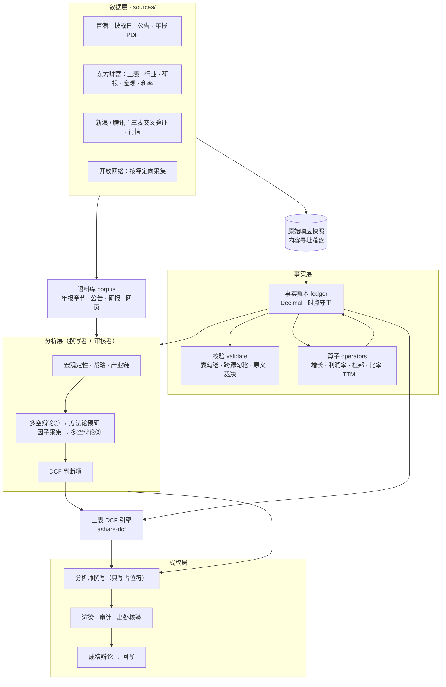
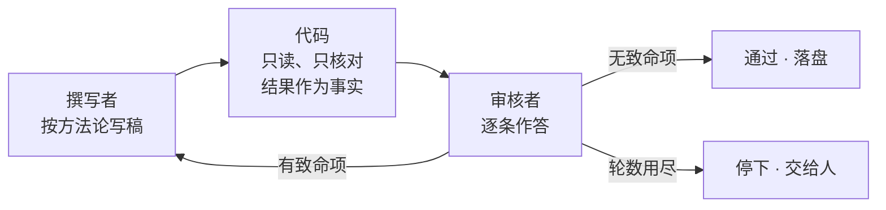

# ir-agent

**一个 A 股个股投研 Agent：让 AI 写研报，但不让它编数字，也不让它未经审核的判断进入估值。**

输入一个股票代码和报告年度，ir-agent 会采集公告、财报、行情、券商研报和公开网页，做宏观、战略、产业链分析，通过两轮多空辩论设计驱动因子并填写 DCF 判断项，最后产出一个三表 DCF 模型和一份完整研报。

三条底线贯穿全流程：

- **数字无法编造。** 模型只能写占位符 `[[key@期间]]`，真值由代码从事实账本填入；每个数字都能反查到当时的原始接口响应。
- **判断都要经过审核。** 凡是需要判断的环节，都由两个 AI 分工完成：一个撰写，一个审核。代码不替它们下结论，只把核对结果作为事实交给审核者。
- **人是最后一道闸。** 全流程有三道人工闸门，缺签名时程序在取数之前就拒绝运行。

> ⚠ 仅供研究与学习，**不构成任何投资建议**。

---

## 功能

| 产出 | 内容 |
|---|---|
| 事实账本、看板、工作簿 | 三表、行情、宏观、利率、行业聚合、可比公司；HTML 看板（单文件、离线可开）与带活公式的 Excel |
| 资料来源清单 | 每份资料的出处、本地文件与原始响应快照，供人逐条核验 |
| 定性分析 | 宏观定性（政策取向与传导路径）、战略分析（护城河、五力、关键不确定性）、产业链（上中下游与议价能力）、商业周期定位 |
| 多空平衡点 | 多空双方从同一份证据中各取所需，由裁决者给出带数值区间的平衡点 |
| 驱动因子分解式 | 用公式写出「这家公司的营收和毛利率由什么驱动」，代码负责求值 |
| 研究简报 | 论证链式的简报，附一份待核清单 |
| DCF 判断项 | 每个因子逐年给出悲观、中性、乐观三档，附理由、依据与审核结论 |
| 三表 DCF 模型 | 公式驱动的工作簿，经独立复算验证 |
| 完整研报 | 含估值一节、成稿辩论与回写，末尾附「判断项依据核验」 |

## 架构



| 层 | 模块 | 职责 |
|---|---|---|
| 数据 | `sources/` | 各数据源适配器；`snapshot` 落盘原始响应；`resolve` 负责多源降级与交叉验证；`retry` 处理瞬时故障 |
| 事实 | `ledger` | 系统里所有数字的唯一入口：带时点守卫，管理修订版本 |
| | `validate/` | 三表勾稽、跨源勾稽；两源分歧时用年报原文裁定 |
| | `operators/` | 确定性算子：增长率、利润率、杜邦、五类比率、TTM、单季拆分、盈余质量 |
| | `industry_facts` · `comparables` · `beta` · `cycle` | 行业聚合、可比公司挑选、自行回归 β、商业周期定位（均不调用模型） |
| 语料 | `corpus` · `sources/annual_sections` · `sources/announce` · `sources/reports` · `sources/openweb` | 把年报之外的文字也变成可引用、可核验的资料 |
| 分析 | `macro_view` · `strategy` · `value_chain` + `qual_review` | 三个定性模块，共用一个审核引擎 |
| | `stance` | 多空辩论：两个子 agent 采集对立证据，由裁决者给出平衡点 |
| | `methodology` · `formula` + `methodology_review` | 方法论预研：设计分解式（公式 DSL），并由审核者把关 |
| | `gaps` · `sources/web` · `sources/conclusions` | 按分解式识别数据缺口，分级定向采集 |
| | `assume` + `assume_review` | 填写 DCF 判断项、合成营收与毛利率路径，并由审核者把关 |
| 估值 | `dcf` · `dcf_data` | 把事实账本铺成三表形状，交给 DCF 引擎建模，并做交叉核对 |
| 成稿 | `analyst` · `citation` · `audit` · `attribution` | 撰写、占位符渲染、验收审计、文字出处核验 |
| | `debate` · `revision` | 成稿辩论（质疑者 → 分析师 → 裁决者），以及把成立的挑战回写进正文 |
| 编排 | `research` · `full` | 四次调用、三道闸门、产物落盘与断点续跑 |
| 模型 | `clients/claude_cli` | 通过 `claude -p` 调用模型，不需要 API key |

## 工作原理

### 1. 事实账本：数字从哪里来

所有数字都只能经由事实账本进入系统。每条事实都带着来源（`source_id`）、期间、单位，以及**它在什么时点可以被知道**（`as_of`）。

- **时点守卫。** `ledger.get(key, 期间, as_of=…)` 只返回该时点已经披露的最新版本；请求尚未披露的数字会抛出 `LookAheadError`。财报的 `as_of` 取自巨潮公告日，既不是抓取日，也不是报表日期。用错日期会让回测凭空多出信息优势，而且不会报错。
- **数字一律用 `Decimal`。** 构造事实时直接拒绝 `float`。
- **原始响应落盘。** 每次接口请求的原始响应按内容寻址保存，事实通过 `source_id` 指回这份快照。
- **多源交叉验证。** 三表以东方财富为主源、新浪交叉验证；行情以腾讯为主源、新浪备份。主源的值胜出，分歧记录在案并显示出来。
- **跳过不等于通过。** 校验报告把「已跑的都过了」和「覆盖完整」分开报告。数据残缺时显示「跳过」，不会伪装成健康。

### 2. 占位符契约：模型怎么写数字

撰写者看到的是一份事实清单，每一行包含标签、显示值和占位符写法：

```text
毛利率          35.00%（账本原值 0.35）   写作 [[gross_margin@2025FY]]
```

正文里只能写占位符，渲染阶段由代码填入真值并生成脚注。撰写稿交回后要先过三道闸：不能有裸数字，不能引用账本里不存在的事实，通篇至少要引用一个占位符。所以模型**物理上无法编造数字**，它能做的只是选择引用哪一个。

文字另有一道闸，专门防「捏造出处」。捏造一个出处比捏造一个数字更容易，也更难被发现。凡是引文紧邻处点名了来源的句子，比如「据年报披露，『……』」「某证券研报指出，『……』」，代码都会核对引文是否真的出自那个来源。没有点名来源的表述不强求标注，否则正文没法读。

### 3. 撰写者 + 审核者：判断怎么把关

凡是需要判断的环节，都按同一个循环运行：宏观定性、战略分析、产业链、方法论预研和 DCF 判断项，都是这个循环。



- **代码只核对，不驳回。** 引文能否在资料里找到、转述指向的文章在不在语料库、单位与口径是否对齐、账本外有没有冒出数字，这些核对结果都作为**事实**交给审核者。代码擅长判断「能不能算、有没有出处」，但判断「论证成不成立」要交给审核者。
- **清单按方法论生成，不按稿子生成。** 比如五力分析永远是 5 条。撰写者漏写的那条会以「未给出」的形式出现在审核者面前，不会因为没写就不被检查。
- **四级结论。** 通过（逻辑完全正确，资料对得上）、提醒（逻辑部分正确，资料对得上，但结论较为牵强）、致命（逻辑完全无法支撑结论，必须附修改建议）、待采集（逻辑正确，但资料尚未采集到）。
- **退回重写。** 有致命项就带着建议退回撰写者。方法论预研最多 5 轮，其余环节最多 3 轮；审核者漏答的条目要求补答，补答不消耗撰写者的轮数。
- **停下比静默降级好。** 轮数用尽、审核者答不全、模型接口失败时，流程都会停下，写明原因、各轮记录的位置，以及重跑或人工接手的方法。
- **撰写者和审核者看到同一份资料。** 审核者手里有的账本事实，撰写者也有，审核者不会拿撰写者从没见过的数据判它致命。

### 4. 从分析到估值：一条可追溯的链

定性分析的结论不会直接变成估值参数，中间要经过四步：

1. **多空辩论①**：按需求、价格、成本、份额、政策五个主题，多空双方从同一份证据里各自取证，裁决者给出每个主题的平衡结论。
2. **方法论预研**：针对辩论中的争执点，设计这家公司的分解式。分解式用一个小型公式语言书写，模型写公式，代码求值：

   ```text
   模式: 变化
   因子: 行业增速 | 玻纤行业营业收入同比增速 | 变化率 | [[industry.revenue_yoy@2025FY]] | 行业增速
   因子: 超额增速 | 本司营收同比相对行业的超额增速 | 变化率 | … | …
   公式: 营收 = 上期(营收) × (1 + 行业增速 + 超额增速)
   公式: 毛利率 = 上期(毛利率) + 结构升级贡献 / 100 − 原燃料成本侵蚀 × 成本传导系数 × (1 − 上期(毛利率))
   ```

   只允许四则运算、因子名、常量名，以及 `上期(·)` 和 `基期(·)`。代码会用历史数据回算这个分解式，报告残差。
3. **因子定向采集**：按分解式找数据缺口，先近后远地采集：账本 → 年报章节 → 公司公告 → 研报语料库 → 开放网络。每条联网结论都列出引用文章，代码逐个核对结论里的数字在文章里有没有出处。
4. **多空辩论②**：对每个因子给出（空方值, 平衡值, 多方值）三元组。DCF 判断项的三档以此为锚，偏离必须写明理由。

判断项填好后，代码按分解式合成营收与毛利率的五年路径，并计算这条路径的算术后果，比如隐含的市场份额，交给审核者判断讲不讲得通。如果首个预测年的中报已经披露，就用实际数据反推全年值，覆盖人批准的首年值（半年报锚定），研报附录会写明这一点。最后由三表 DCF 引擎建模，并与事实账本交叉核对。

### 5. 三道人工闸门与断点续跑

| 调用 | 做什么 | 停在 |
|---|---|---|
| ① `--analyse` | 采集、语料库入库、三个定性模块 | 门①：核验资料来源 |
| ② `--brief` | 多空辩论① → 方法论预研 → 因子采集 → 多空辩论② → 简报 | 门②：审阅简报结论 |
| ③ `--assume` | 填写 DCF 判断项 | 门③：核实判断项 |
| ④ `--value` | 三表 DCF 建模 → 完整研报 → 成稿辩论 → 回写 | — |

- **签名是前置条件。** 每道闸门的签名记录在对应产物里，缺签名时在取数之前就拒绝运行。
- **断点续跑。** 每次调用都先重建确定性层（不花模型的钱），再读回上一次的产物。任何一步失败，只需重跑那一步；已经通过的模块直接沿用，不再调用模型。
- **人工接手有标记。** 人可以以最后一稿为底稿改好再重跑。改过的部分会一路标注「人工修改后未经审核」，直到写进研报附录。

### 6. 两种辩论：证伪而不是附和

- **多空辩论**（`stance`，发生在建模之前）：防的是「证据被单向挑选」。多空双方面对同一份证据，裁决者只能在两侧划出的区间内选平衡点。
- **成稿辩论**（`debate`，发生在成稿之后）：质疑者必须指向原文的具体片段，并归类为逻辑错误、无据断言、反面证据被忽略或假设不当。其中「无据断言」尤其重要：占位符契约拦得住编造的数字，拦不住编造的背景。分析师回应后，由裁决者判定哪些挑战成立。成立的挑战要回写进正文，代码会机械核验：被质疑的原句不得在修订稿中原样保留，以防「口头接受、实际没改」。

## 快速开始

**依赖**

- Python 3.13；`requests`、`openpyxl`、`PyMuPDF`、`pandas`
- 已登录的 [Claude Code](https://claude.com/claude-code) CLI（模型通过 `claude -p` 调用，**不需要 API key**）
- 第 ④ 步的三表 DCF 建模依赖配套引擎 `ashare-dcf`（默认位于本仓库的同级目录，可用 `ASHARE_DCF_DIR` 指定）。该引擎**尚未公开**；没有它，前三次调用仍可完整运行。

**只跑确定性层**（不调用模型）：

```bash
python -m ir_agent 600519 --year 2025
```

**完整流程**（每一步之后检查产物，用你的名字签闸门）：

```bash
python -m ir_agent 600176 --year 2025 --analyse out/600176
python -m ir_agent 600176 --year 2025 --brief   out/600176 --verified-by <你的名字>
python -m ir_agent 600176 --year 2025 --assume  out/600176 --reviewed-by <你的名字>
python -m ir_agent 600176 --year 2025 --value   out/600176 --approved-by <你的名字>
```

请保留代码里的限流等待：东方财富有 IP 频控。项目按 TDD 开发，`python -m pytest -q -m "not live"` 运行离线测试。

## 现状与限制

- **北交所**没有可用的财报数据源，明确不支持。
- **一致预期**在免费数据源里没有可靠覆盖。
- 部分来源（东方财富宏观页面、研报 PDF 抽取的数字）**无法保留原始接口响应**，审计时会单独列出，不当作通过。
- 全流程**串行**运行。
- 第 ④ 步依赖的 `ashare-dcf` 引擎尚未公开。

## 更多文档

- [`docs/DESIGN-NOTES.md`](docs/DESIGN-NOTES.md)：工程笔记，包括数据源取舍、口径陷阱和每条设计约束的来由
- [`docs/superpowers/specs/`](docs/superpowers/specs/)：各子项目的设计文档
- [`docs/superpowers/plans/`](docs/superpowers/plans/)：对应的实现计划

## 许可证

[MIT](LICENSE)

---

**免责声明**：本项目及其产出仅用于研究与学习，不构成任何投资建议。数据来自公开渠道，可能存在错误或延迟；模型生成的分析可能有误。据此做出的任何投资决策，风险自负。
