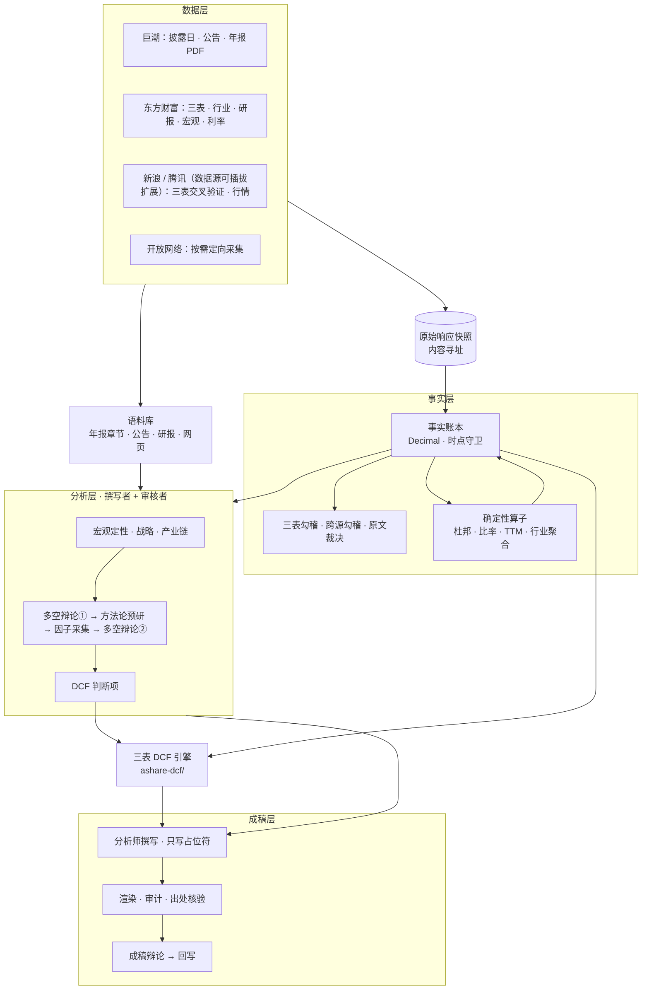
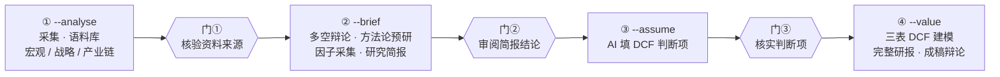
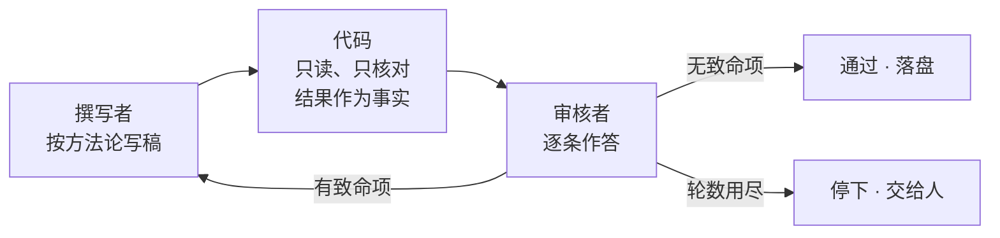

<div align="center">

# ir-agent

**A 股个股投研 Agent —— 从原始披露到三表 DCF 估值，每个数字可溯源，每个判断经审核。**


**简体中文** · [繁體中文](README.zh-TW.md) · [English](README.en.md)

</div>

---

输入一个股票代码和报告年度，ir-agent 会完成一位卖方分析师的完整工作流：采集公告、财报、行情、券商研报与公开网页；完成宏观、战略、产业链分析；通过两轮多空辩论设计驱动因子；填写 DCF 判断项；最终交付**一个公式驱动、可逐格复算的三表 DCF 模型**和**一份完整研报**。

它要解决的是 LLM 写研报的两类失败：**编造数字**，以及**未经推敲的判断直接进入估值**。

> ⚠ 本项目仅供研究与学习，**不构成任何投资建议**。

## 核心特性

| | |
|---|---|
| 🔢 **数字物理上无法编造** | 模型只写占位符 `[[key@期间]]`，真值由代码从事实账本渲染；裸数字、伪造引用一律被审计拦下。 |
| ⏱ **严格的时点纪律** | 每条事实带「可知时点」，取值时守卫拒绝尚未披露的数据；披露日取自巨潮公告日，杜绝回测中的信息泄漏。 |
| ⚖️ **撰写者 + 审核者** | 每个判断环节由两个 AI 分工完成。代码只核对、不下结论；审核者按方法论生成的清单逐条给出四级结论，致命项带建议退回重写。 |
| 🧭 **证伪而非附和** | 建模前的多空辩论防止证据被单向挑选；成稿后的辩论逐条质疑原文，成立的挑战必须回写进正文。 |
| 📊 **专业级三表 DCF 引擎** | 三表联动、资产负债表强制平衡、Damodaran 一致性终值、五组敏感性矩阵、蒙特卡洛模拟——全部为活公式，生成后用公式引擎逐格复算验证。 |
| 🚦 **人是最后一道闸** | 三道人工闸门，缺签名即拒绝运行；任何一步失败可单独重跑，通过的结果自动沿用。 |

## 系统全景



## 工作流程：四次调用，三道闸门



| 调用 | 做什么 | 交给人审阅 |
|---|---|---|
| ① `--analyse` | 定量采集、语料库入库；宏观定性、战略分析、产业链（各自撰写 + 审核） | 资料来源清单（每份资料的出处、本地文件与原始快照）与三个定性模块的审核结论 |
| ② `--brief` | 多空辩论① → 方法论预研（设计营收与毛利率的分解式）→ 因子定向采集 → 多空辩论②（每个因子的空方 / 平衡 / 多方值）→ 研究简报 | 简报、待核清单、分解式、平衡点 |
| ③ `--assume` | AI 按分解式逐年填三档判断项，代码合成营收与毛利率路径 | 每一行的取值、理由、依据与审核结论 |
| ④ `--value` | 三表 DCF 建模 → 完整研报 → 成稿辩论 → 回写 | 研报与 DCF 工作簿 |

每次调用先重建不调用模型的确定性层，再读回上一次的产物继续。任何一步失败只需重跑那一步；人工接手改过的结果会一路标注「人工修改后未经审核」，直到写进研报附录。

## 工作原理

### 事实账本：数字从哪里来

所有数字只能经由事实账本进入系统。每条事实携带来源、期间、单位，以及**它在什么时点可以被知道**。`ledger.get(key, 期间, as_of=…)` 只返回该时点已披露的最新版本；请求未披露的数字抛出 `LookAheadError`。原始接口响应按内容寻址落盘，事实通过 `source_id` 指回快照。三表以东方财富为主源、新浪交叉验证，分歧记录在案并显示。校验报告把「已跑的都过了」与「覆盖完整」分开报告——缺数据时标「跳过」，不伪装成通过。

### 占位符契约：模型怎么写数字

撰写者看到的是一份事实清单，每行包含标签、显示值与占位符；比率类事实同时给出账本原值，避免百分数与小数之间的 100 倍误读：

```text
毛利率          35.00%（账本原值 0.35）   写作 [[gross_margin@2025FY]]
```

正文只能写占位符，渲染阶段由代码填真值并生成脚注。交稿要过三道数字闸：无裸数字、无伪造引用、至少引用一个占位符。另有一道**出处闸**专防捏造来源——凡点名来源的引文（「据年报披露，『……』」），代码都核对它是否真的出自该来源。

### 撰写者 + 审核者：判断怎么把关



| 结论 | 含义 |
|---|---|
| 通过 | 逻辑完全正确，资料能够对得上 |
| 提醒 | 逻辑部分正确，资料对得上，但结论较为牵强 |
| 致命 | 逻辑完全无法支撑结论（必须附修改建议） |
| 待采集 | 逻辑正确，但资料尚未采集到 |

- **代码只核对，不驳回。** 引文是否存在、转述的文章在不在语料库、单位口径是否对齐——都作为事实交给审核者。代码擅长判断「能不能算、有没有出处」，「论证成不成立」交给审核者。
- **清单按方法论生成。** 五力永远是 5 条，撰写者漏写的那条以「未给出」出现在审核者面前。
- **撰写者与审核者看到同一份资料**——审核者不会拿撰写者从未见过的数据判它致命。
- **停下好过静默降级。** 方法论预研最多 5 轮，其余环节 3 轮；用尽仍不通过，写明原因与各轮记录，交人处理。

### 从分析到估值：一条可追溯的链

1. **多空辩论①**：按需求、价格、成本、份额、政策五个主题，多空双方从同一份证据中各自取证，裁决者给出平衡结论。
2. **方法论预研**：针对争执点设计这家公司的分解式——模型写公式，代码求值，并用历史数据回算报告残差：

   ```text
   模式: 水平
   公式: 营收   = 全国出栏 × 出栏份额 × 出栏均重 × 生猪均价 × 屠宰溢价 / 10000
   公式: 毛利率 = (生猪均价 − 料肉比 × 饲料单价 − 非饲料成本) / (生猪均价 × 屠宰溢价)
   ```

3. **因子定向采集**：按分解式识别数据缺口，先近后远——账本 → 年报章节 → 公司公告 → 研报 → 开放网络；联网结论逐个核对数字出处。
4. **多空辩论②**：对每个因子给出（空方, 平衡, 多方）三元组，判断项的三档以此为锚，偏离须写明理由。
5. **首年锚定**：若本年已有季报，首个预测年按季度估算——已公布季度用实际，其余季度按年初至今同比外推，三档相同；不能估算时写明原因、回到判断项。

### 两种辩论

- **多空辩论**（建模之前）：多空双方面对同一份证据，裁决者只能在两侧划出的区间内选平衡点，防止证据被单向挑选。
- **成稿辩论**（成稿之后）：质疑者必须指向原文具体片段，并归类为逻辑错误、无据断言、反面证据被忽略或假设不当；成立的挑战回写正文，代码机械核验被质疑的原句不得原样保留。

## 三表 DCF 引擎（`ashare-dcf/`）

可独立使用：输入一个 A 股代码，产出**全公式、可编辑**的 Excel 模型——改 `1_假设` 中任一蓝色单元格，全表自动重算。

| 页签 | 内容 |
|---|---|
| `1_假设` | 情景开关、判断项、自动校准假设、首年季度估算、期初余额、DCF 参数、股本与融资 |
| `1b_驱动分解` | 与 ir-agent 分解式同记号的 Excel 公式（常量区、基期区、营收水平与增速） |
| `2_利润表` / `3_资产负债表` / `4_现金流量表` | 历史实际 + 公式预测；资产负债表强制平衡，循环贷自动调节 |
| `5_DCF` | WACC、FCFF 现值、正常化终值、EV → 每股、反向 DCF、五组敏感性矩阵 |
| `7_财务比率与杜邦` | 五组比率 + 杜邦三 / 五因子分解 + 图表，全部活公式 |
| `8_蒙特卡洛` | 相关抽样（Cholesky）、分布统计、龙卷风图；参数存在 Excel，计算在 Python |

- **方法论**：终值遵循 Damodaran 一致性（`RR = g / ROIC`）；期中折现；非经营资产加回；少数股东双口径；终值税率单列。
- **内建验证**：生成后用 `formulas` 引擎实跑工作簿公式，与 Python 独立重算逐格比对——平衡校验、DCF 全链路、杜邦恒等式、敏感性中心格复现基准；任一失败即非零退出，不交付坏文件。
- **健全性警告**：终值占比过高、终值 ROIC ≤ WACC、预测期 EBIT ≤ 0 等情形逐条提示。
- **适用范围**：不支持银行 / 保险 / 券商（自由现金流不可定义）与上市不足 5 年的公司。

## 快速开始

**依赖**

- Python 3.13
- `requests` `openpyxl` `PyMuPDF` `pandas` `numpy` `akshare` `formulas`
- 已登录的 [Claude Code](https://claude.com/claude-code) CLI —— 模型通过 `claude -p` 调用，**不需要 API key**

**只跑确定性层**（不调用模型）：事实账本、三表勾稽、可溯源审计、看板与工作簿。

```bash
python -m ir_agent 600519 --year 2025
```

**完整流程**（每一步之后审阅产物，用你的名字签闸门）：

```bash
python -m ir_agent 002714 --year 2025 --analyse out/002714
python -m ir_agent 002714 --year 2025 --brief   out/002714 --verified-by <你的名字>
python -m ir_agent 002714 --year 2025 --assume  out/002714 --reviewed-by <你的名字>
python -m ir_agent 002714 --year 2025 --value   out/002714 --approved-by <你的名字>
```

**单独使用 DCF 引擎**：

```bash
python ashare-dcf/ashare_dcf.py 600183 --years 5 --mc
```

**测试**：

```bash
python -m pytest -q -m "not live"            # ir-agent（离线）
python -m pytest -q ashare-dcf/tests         # DCF 引擎
```

> 请保留代码中的限流等待：东方财富有 IP 频控。

## 项目结构

```text
ir-agent/
├── ir_agent/              投研 Agent
│   ├── sources/           数据源适配器、快照、多源交叉验证
│   ├── operators/         确定性算子（杜邦、比率、TTM、单季拆分……）
│   ├── validate/          三表勾稽、跨源勾稽、原文裁决
│   ├── clients/           模型调用（claude -p）
│   └── *.py               账本、定性分析、辩论、方法论、判断项、成稿、编排
├── ashare-dcf/            三表 DCF 引擎（校准、建模、验证、蒙特卡洛）
├── tests/                 ir-agent 测试
├── docs/
│   ├── design/            各子项目的设计文档：为什么这样设计、做过哪些取舍
│   └── DESIGN-NOTES.md    工程笔记：数据源取舍、口径陷阱、被测试抓到的真实缺陷
└── scripts/               批量运行工具
```

## 设计原则

1. **数字一律 `Decimal`**，构造事实时拒绝 `float`。
2. **取值必须带时点**，未披露的数字取不到。
3. **模型只写占位符**，真值由代码渲染。
4. **缺数据标「跳过」，不标「通过」。**
5. **代码只核对，判断交给审核者。**
6. **停下好过静默降级**：失败时写明原因、记录位置与恢复方法。
7. **测试先行**：先写会失败的测试，再实现；关键规则做变异验证。

## 现状与限制

- 北交所没有可用的财报数据源，明确不支持。
- 一致预期在免费数据源里没有可靠覆盖。
- 部分来源（东方财富宏观页面、研报 PDF 抽取的数字）无法保留原始接口响应，审计时单独列出。
- 全流程串行运行：东方财富频控需要先有限流策略才能并发。

## 文档

- [`docs/design/`](docs/design/) —— 设计文档（事实账本、语料库、分解式公式化、三类审核者、DCF 模板……）
- [`docs/DESIGN-NOTES.md`](docs/DESIGN-NOTES.md) —— 工程笔记与踩坑记录
- [`ashare-dcf/README.md`](ashare-dcf/README.md) —— DCF 引擎完整说明（工作簿结构、敏感性、蒙特卡洛、口径决定）

## 许可证

[MIT](LICENSE)

---

<sub>**免责声明**：本项目及其产出仅用于研究与学习，不构成任何投资建议。数据来自公开渠道，可能存在错误或延迟；模型生成的分析可能有误。据此做出的任何投资决策，风险自负。</sub>
