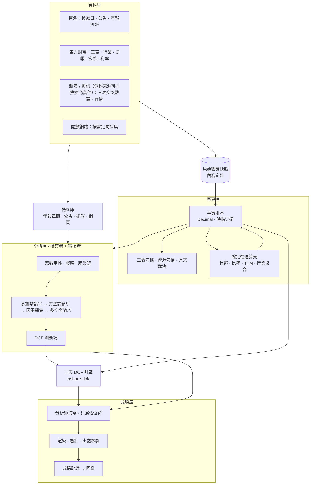
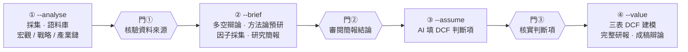
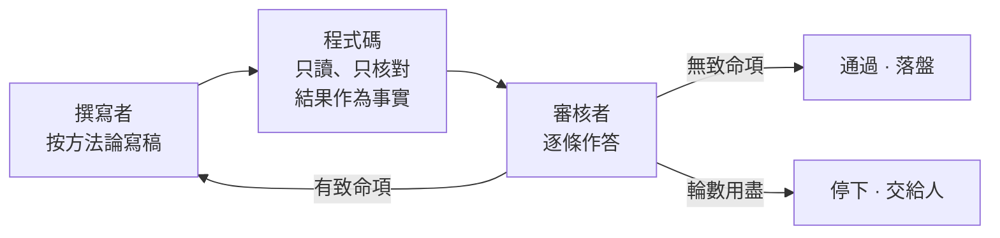

<div align="center">

# ir-agent

**A 股個股投研 Agent —— 從原始披露到三表 DCF 估值，每個數字可溯源，每個判斷經審核。**


[简体中文](README.md) · **繁體中文** · [English](README.en.md)

</div>

---

輸入一個股票代號和報告年度，ir-agent 會完成一位賣方分析師的完整工作流：採集公告、財報、行情、券商研報與公開網頁；完成宏觀、戰略、產業鏈分析；透過兩輪多空辯論設計驅動因子；填寫 DCF 判斷項；最終交付**一個公式驅動、可逐格復算的三表 DCF 模型**和**一份完整研報**。

它要解決的是 LLM 寫研報的兩類失敗：**編造數字**，以及**未經推敲的判斷直接進入估值**。

> ⚠ 本專案僅供研究與學習，**不構成任何投資建議**。

## 核心特性

| | |
|---|---|
| 🔢 **數字物理上無法編造** | 模型只寫佔位符 `[[key@期间]]`，真值由程式碼從事實賬本渲染；裸數字、偽造引用一律被審計攔下。 |
| ⏱ **嚴格的時點紀律** | 每條事實帶「可知時點」，取值時守衛拒絕尚未披露的資料；披露日取自巨潮公告日，杜絕回測中的資訊洩漏。 |
| ⚖️ **撰寫者 + 審核者** | 每個判斷環節由兩個 AI 分工完成。程式碼只核對、不下結論；審核者按方法論生成的清單逐條給出四級結論，致命項帶建議退回重寫。 |
| 🧭 **證偽而非附和** | 建模前的多空辯論防止證據被單向挑選；成稿後的辯論逐條質疑原文，成立的挑戰必須回寫進正文。 |
| 📊 **專業級三表 DCF 引擎** | 三表聯動、資產負債表強制平衡、Damodaran 一致性終值、五組敏感性矩陣、蒙特卡洛模擬——全部為活公式，生成後用公式引擎逐格復算驗證。 |
| 🚦 **人是最後一道閘** | 三道人工閘門，缺簽名即拒絕執行；任何一步失敗可單獨重跑，通過的結果自動沿用。 |

## 系統全景



## 工作流程：四次呼叫，三道閘門



| 呼叫 | 做什麼 | 交給人審閱 |
|---|---|---|
| ① `--analyse` | 定量採集、語料庫入庫；宏觀定性、戰略分析、產業鏈（各自撰寫 + 審核） | 資料來源清單（每份資料的出處、本地檔案與原始快照）與三個定性模組的審核結論 |
| ② `--brief` | 多空辯論① → 方法論預研（設計營收與毛利率的分解式）→ 因子定向採集 → 多空辯論②（每個因子的空方 / 平衡 / 多方值）→ 研究簡報 | 簡報、待核清單、分解式、平衡點 |
| ③ `--assume` | AI 按分解式逐年填三檔判斷項，程式碼合成營收與毛利率路徑 | 每一行的取值、理由、依據與審核結論 |
| ④ `--value` | 三表 DCF 建模 → 完整研報 → 成稿辯論 → 回寫 | 研報與 DCF 工作簿 |

每次呼叫先重建不呼叫模型的確定性層，再讀回上一次的產物繼續。任何一步失敗只需重跑那一步；人工接手改過的結果會一路標註「人工修改後未經審核」，直到寫進研報附錄。

## 工作原理

### 事實賬本：數字從哪裡來

所有數字只能經由事實賬本進入系統。每條事實攜帶來源、期間、單位，以及**它在什麼時點可以被知道**。`ledger.get(key, 期间, as_of=…)` 只返回該時點已披露的最新版本；請求未披露的數字丟擲 `LookAheadError`。原始介面響應按內容定址落盤，事實透過 `source_id` 指回快照。三表以東方財富為主源、新浪交叉驗證，分歧記錄在案並顯示。校驗報告把「已跑的都過了」與「覆蓋完整」分開報告——缺資料時標「跳過」，不偽裝成通過。

### 佔位符契約：模型怎麼寫數字

撰寫者看到的是一份事實清單，每行包含標籤、顯示值與佔位符；比率類事實同時給出賬本原值，避免百分數與小數之間的 100 倍誤讀：

```text
毛利率          35.00%（账本原值 0.35）   写作 [[gross_margin@2025FY]]
```

正文只能寫佔位符，渲染階段由程式碼填真值並生成腳註。交稿要過三道數字閘：無裸數字、無偽造引用、至少引用一個佔位符。另有一道**出處閘**專防捏造來源——凡點名來源的引文（「據年報披露，『……』」），程式碼都核對它是否真的出自該來源。

### 撰寫者 + 審核者：判斷怎麼把關



| 結論 | 含義 |
|---|---|
| 通過 | 邏輯完全正確，資料能夠對得上 |
| 提醒 | 邏輯部分正確，資料對得上，但結論較為牽強 |
| 致命 | 邏輯完全無法支撐結論（必須附修改建議） |
| 待採集 | 邏輯正確，但資料尚未採集到 |

- **程式碼只核對，不駁回。** 引文是否存在、轉述的文章在不在語料庫、單位口徑是否對齊——都作為事實交給審核者。程式碼擅長判斷「能不能算、有沒有出處」，「論證成不成立」交給審核者。
- **清單按方法論生成。** 五力永遠是 5 條，撰寫者漏寫的那條以「未給出」出現在審核者面前。
- **撰寫者與審核者看到同一份資料**——審核者不會拿撰寫者從未見過的資料判它致命。
- **停下好過靜默降級。** 方法論預研最多 5 輪，其餘環節 3 輪；用盡仍不通過，寫明原因與各輪記錄，交人處理。

### 從分析到估值：一條可追溯的鏈

1. **多空辯論①**：按需求、價格、成本、份額、政策五個主題，多空雙方從同一份證據中各自取證，裁決者給出平衡結論。
2. **方法論預研**：針對爭執點設計這家公司的分解式——模型寫公式，程式碼求值，並用歷史資料回算報告殘差：

   ```text
   模式: 水平
   公式: 营收   = 全国出栏 × 出栏份额 × 出栏均重 × 生猪均价 × 屠宰溢价 / 10000
   公式: 毛利率 = (生猪均价 − 料肉比 × 饲料单价 − 非饲料成本) / (生猪均价 × 屠宰溢价)
   ```

3. **因子定向採集**：按分解式識別資料缺口，先近後遠——賬本 → 年報章節 → 公司公告 → 研報 → 開放網路；聯網結論逐個核對數字出處。
4. **多空辯論②**：對每個因子給出（空方, 平衡, 多方）三元組，判斷項的三檔以此為錨，偏離須寫明理由。
5. **首年錨定**：若本年已有季報，首個預測年按季度估算——已公佈季度用實際，其餘季度按年初至今同比外推，三檔相同；不能估算時寫明原因、回到判斷項。

### 兩種辯論

- **多空辯論**（建模之前）：多空雙方面對同一份證據，裁決者只能在兩側劃出的區間內選平衡點，防止證據被單向挑選。
- **成稿辯論**（成稿之後）：質疑者必須指向原文具體片段，並歸類為邏輯錯誤、無據斷言、反面證據被忽略或假設不當；成立的挑戰回寫正文，程式碼機械核驗被質疑的原句不得原樣保留。

## 三表 DCF 引擎（`ashare-dcf/`）

可獨立使用：輸入一個 A 股代號，產出**全公式、可編輯**的 Excel 模型——改 `1_假设` 中任一藍色單元格，全表自動重算。

| 頁籤 | 內容 |
|---|---|
| `1_假设` | 情景開關、判斷項、自動校準假設、首年季度估算、期初餘額、DCF 引數、股本與融資 |
| `1b_驱动分解` | 與 ir-agent 分解式同記號的 Excel 公式（常量區、基期區、營收水平與增速） |
| `2_利润表` / `3_资产负债表` / `4_现金流量表` | 歷史實際 + 公式預測；資產負債表強制平衡，迴圈貸自動調節 |
| `5_DCF` | WACC、FCFF 現值、正常化終值、EV → 每股、反向 DCF、五組敏感性矩陣 |
| `7_财务比率与杜邦` | 五組比率 + 杜邦三 / 五因子分解 + 圖表，全部活公式 |
| `8_蒙特卡洛` | 相關抽樣（Cholesky）、分佈統計、龍捲風圖；引數存在 Excel，計算在 Python |

- **方法論**：終值遵循 Damodaran 一致性（`RR = g / ROIC`）；期中折現；非經營資產加回；少數股東雙口徑；終值稅率單列。
- **內建驗證**：生成後用 `formulas` 引擎實跑工作簿公式，與 Python 獨立重算逐格比對——平衡校驗、DCF 全鏈路、杜邦恆等式、敏感性中心格復現基準；任一失敗即非零退出，不交付壞檔案。
- **健全性警告**：終值佔比過高、終值 ROIC ≤ WACC、預測期 EBIT ≤ 0 等情形逐條提示。
- **適用範圍**：不支援銀行 / 保險 / 券商（自由現金流不可定義）與上市不足 5 年的公司。

## 快速開始

**依賴**

- Python 3.13
- `requests` `openpyxl` `PyMuPDF` `pandas` `numpy` `akshare` `formulas`
- 已登入的 [Claude Code](https://claude.com/claude-code) CLI —— 模型透過 `claude -p` 呼叫，**不需要 API key**

**只跑確定性層**（不呼叫模型）：事實賬本、三表勾稽、可溯源審計、看板與工作簿。

```bash
python -m ir_agent 600519 --year 2025
```

**完整流程**（每一步之後審閱產物，用你的名字籤閘門）：

```bash
python -m ir_agent 002714 --year 2025 --analyse out/002714
python -m ir_agent 002714 --year 2025 --brief   out/002714 --verified-by <你的名字>
python -m ir_agent 002714 --year 2025 --assume  out/002714 --reviewed-by <你的名字>
python -m ir_agent 002714 --year 2025 --value   out/002714 --approved-by <你的名字>
```

**單獨使用 DCF 引擎**：

```bash
python ashare-dcf/ashare_dcf.py 600183 --years 5 --mc
```

**測試**：

```bash
python -m pytest -q -m "not live"            # ir-agent（离线）
python -m pytest -q ashare-dcf/tests         # DCF 引擎
```

> 請保留程式碼中的限流等待：東方財富有 IP 頻控。

## 專案結構

```text
ir-agent/
├── ir_agent/              投研 Agent
│   ├── sources/           数据源适配器、快照、多源交叉验证
│   ├── operators/         确定性算子（杜邦、比率、TTM、单季拆分……）
│   ├── validate/          三表勾稽、跨源勾稽、原文裁决
│   ├── clients/           模型调用（claude -p）
│   └── *.py               账本、定性分析、辩论、方法论、判断项、成稿、编排
├── ashare-dcf/            三表 DCF 引擎（校准、建模、验证、蒙特卡洛）
├── tests/                 ir-agent 测试
├── docs/
│   ├── design/            各子项目的设计文档：为什么这样设计、做过哪些取舍
│   └── DESIGN-NOTES.md    工程笔记：数据源取舍、口径陷阱、被测试抓到的真实缺陷
└── scripts/               批量运行工具
```

## 設計原則

1. **數字一律 `Decimal`**，構造事實時拒絕 `float`。
2. **取值必須帶時點**，未披露的數字取不到。
3. **模型只寫佔位符**，真值由程式碼渲染。
4. **缺資料標「跳過」，不標「通過」。**
5. **程式碼只核對，判斷交給審核者。**
6. **停下好過靜默降級**：失敗時寫明原因、記錄位置與恢復方法。
7. **測試先行**：先寫會失敗的測試，再實現；關鍵規則做變異驗證。

## 現狀與限制

- 北交所沒有可用的財報資料來源，明確不支援。
- 一致預期在免費資料來源裡沒有可靠覆蓋。
- 部分來源（東方財富宏觀頁面、研報 PDF 抽取的數字）無法保留原始介面響應，審計時單獨列出。
- 全流程序列執行：東方財富頻控需要先有限流策略才能併發。

## 文件

- [`docs/design/`](docs/design/) —— 設計文件（事實賬本、語料庫、分解式公式化、三類審核者、DCF 模板……）
- [`docs/DESIGN-NOTES.md`](docs/DESIGN-NOTES.md) —— 工程筆記與踩坑記錄
- [`ashare-dcf/README.md`](ashare-dcf/README.md) —— DCF 引擎完整說明（工作簿結構、敏感性、蒙特卡洛、口徑決定）

## 許可證

[MIT](LICENSE)

---

<sub>**免責宣告**：本專案及其產出僅用於研究與學習，不構成任何投資建議。資料來自公開渠道，可能存在錯誤或延遲；模型生成的分析可能有誤。據此做出的任何投資決策，風險自負。</sub>
